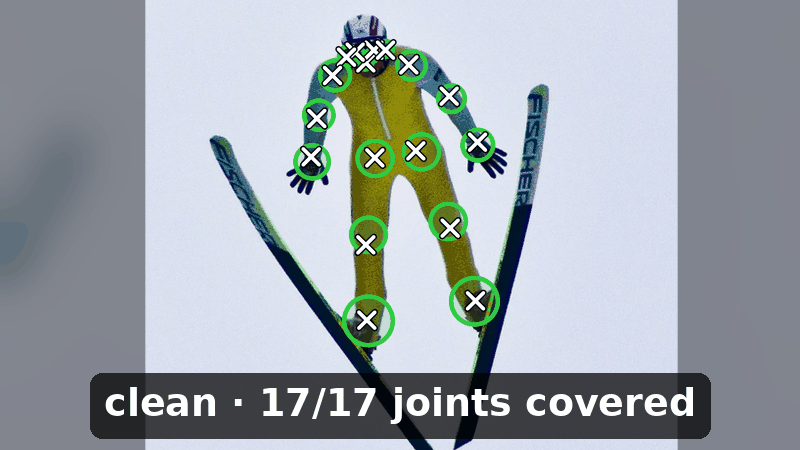
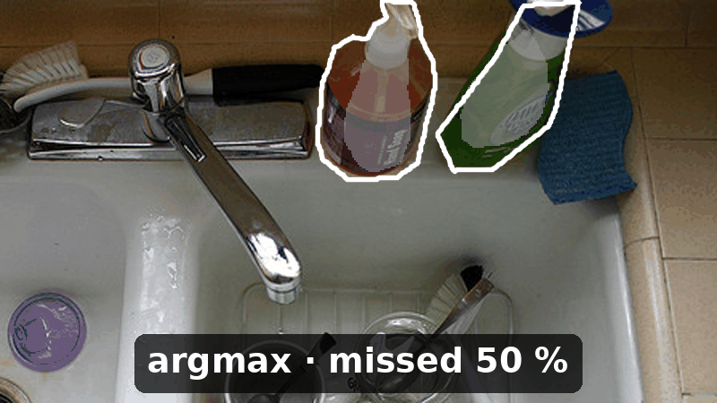

## Hi, I'm Hessam Kaveh 👋

**Research Fellow at the [Italian Institute of Technology (IIT)](https://www.iit.it)**, Italy.

I work on **computer vision for robotics**: perception for robotic manipulation, RGB-D object detection and 6D pose
estimation, and calibration on industrial arms. I'm also interested in **deep learning for medical imaging** and
**explainable AI**.

Most of my repositories are small studies built around one question: not "can I train model X", but *when can a
robot (or a clinician) trust what the model says, and when does it quietly fail?*

  
  
  
 6D screw pose from RGB-D · 90 % conformal safety discs on keypoints as the camera degrades · risk-controlled masks (VOC-calibrated, shown on COCO) under motion blur

---

### 🔬 Research questions

| Question | Short answer |
|---|---|
| [**How close can a robot get to a person?**](https://github.com/HessamKaveh/pose-safety-margins) Conformal safety margins for human keypoints · COCO | Per-joint 90 % discs leave half of all people with a joint outside; a whole-body score restores the guarantee, but motion blur breaks it (52–86 % coverage). |
| [**Which explanations of a dental AI model can be trusted?**](https://github.com/HessamKaveh/caries-xai) Caries detection on intraoral photos · AlphaDent | Integrated Gradients agrees best with expert lesion masks (71 % pointing game, Grad-CAM 55 %); random splits instead of per-patient ones inflate AUROC by 3 points. |
| [**Does a point-cloud classifier survive a real depth camera?**](https://github.com/HessamKaveh/3d-pointcloud-classification) PointNet / DGCNN · ModelNet40 vs simulated RGB-D scans | No: 92 % on CAD models drops to 16 % on realistic scans. Training on simulated scans brings it back to 80 %. |
| [**Can a segmentation mask come with a guarantee?**](https://github.com/HessamKaveh/segmentation-risk-control) Conformal risk control · DeepLabV3 / LR-ASPP · PASCAL VOC | Yes on clean images (missed object pixels 28 % → 10 %), but small objects stay under-covered and motion blur breaks it (56 % missed). |
| [**Can a few-shot classifier say "I don't know"?**](https://github.com/HessamKaveh/few-shot-open-set) Open-set few-shot recognition · CIFAR-100 | Barely: while keeping 95 % of taught objects, at least 59 % of never-taught objects are still accepted. |
| [**Does self-supervision make vision robust, or just label-efficient?**](https://github.com/HessamKaveh/simclr-contrastive-learning) SimCLR vs supervised · CIFAR-10 with camera corruptions | Only label-efficient. Putting the camera's corruptions into the SimCLR augmentations adds robustness, matching supervised training with 10× more labels. |

### 🤖 Robotics

* [**screwpose**](https://github.com/HessamKaveh/6d-pose-screw-detection): model-free screw/nut detection (YOLO11) and
  6D pose from RGB-D for bin-picking. Median position error 0.37 mm; 96 % of objects within 5 mm / 5°.
* At IIT: ROS 2 perception for UR5e and UR15 arms with a ZED 2i stereo camera, including hand-eye calibration and
  screw detection and tracking.

### 📄 Selected publications

* **Advancing civil infrastructure with digital twins: a review of applications and challenges**. H. Kaveh, R. Alhajj.
  *Journal of Civil Engineering and Management* 31(8), 2025.
* **Recent advances in crack detection technologies for structures: a survey of 2022–2023 literature**. H. Kaveh, R. Alhajj.
  *Frontiers in Built Environment* 10, 2024.
* **Employing vision transformers for crack detection and health monitoring of concrete structures**. H. Kaveh, R. Alhajj.
  *International Journal of Reliability and Safety* 20(2), 2026.
* **Toxic language and threat detection in social media**. N. J. Tofighi, H. Kaveh, et al. *ICSAI* 2025.

Full list on [Google Scholar](https://scholar.google.com/citations?user=YE8Qk2gAAAAJ).

### 📚 Other projects

* [Diabetes risk in NHANES](https://github.com/HessamKaveh/nhanes-sex-ml): Elastic Net vs XGBoost with SHAP, women vs men (R)
* Reproductions trained on real benchmarks:
  [multi-object tracking (MOT17)](https://github.com/HessamKaveh/object-tracking-sort) ·
  [optical flow (FlyingChairs → KITTI)](https://github.com/HessamKaveh/optical-flow-estimation) ·
  [human pose (COCO)](https://github.com/HessamKaveh/human-pose-estimation) ·
  [video action recognition (UCF101)](https://github.com/HessamKaveh/video-action-recognition) ·
  [pix2pix (Facades)](https://github.com/HessamKaveh/pix2pix-image-translation)

---

Python · PyTorch · ROS 2 · OpenCV · conformal prediction · explainable AI
